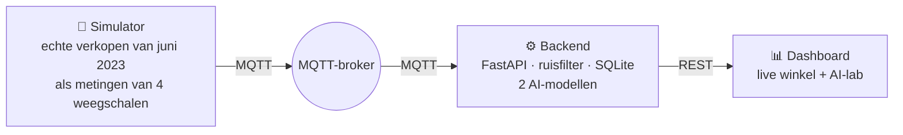

<div align="center">

# ⚖️ GramIQ

**Een slimme weegschaal onder elke groentebak.**<br>
De winkel weet hoeveel er nog ligt, de AI voorspelt wanneer een bak leeg raakt en hoeveel er besteld moet worden.

[](https://jonaskee.github.io/Ai_Business_prototype/)
[](https://www.python.org/downloads/)
[](https://www.kaggle.com/datasets/yapwh1208/supermarket-sales-data)

[🎮 Meteen proberen](#proberen) · [🚀 Zelf opstarten](#opstarten) · [🧪 Wat je kan testen](#testen) · [🛠️ Problemen?](#problemen)

</div>

---

<a id="proberen"></a>

## 🎮 Meteen proberen (niets installeren)

### **→ [jonaskee.github.io/Ai_Business_prototype](https://jonaskee.github.io/Ai_Business_prototype/)**

Een 3D-winkel speelt een echte verkoopdag af, twee keer tegelijk: één winkel met GramIQ en één zonder.
Klik op **🎮 Speel zelf** en word zelf de medewerker: vul de bakken op tijd bij (klikken of toetsen
<kbd>1</kbd>–<kbd>4</kbd>) en zie om 22u of je het beter deed dan de AI. Durf je het ook blind, zonder weegschaal?

Werkt in elke browser, ook op je gsm.

<a id="opstarten"></a>

## 🚀 Zelf opstarten (één klik)

Je hebt enkel **Python 3.10 of nieuwer** nodig ([download](https://www.python.org/downloads/); vink op Windows
*Add python.exe to PATH* aan). Docker en Node.js zijn **niet** nodig.

```bash
git clone https://github.com/Jonaskee/Ai_Business_prototype.git
cd Ai_Business_prototype
```

| Windows | macOS / Linux | Overal |
|---|---|---|
| dubbelklik op **`start.bat`** | `./start.sh` | `python start.py` |

De eerste keer installeert het script alles in een eigen map `.venv` (enkele minuten, afhankelijk van je
internet). Daarna start alles in een paar seconden en opent je browser **http://127.0.0.1:8000**.
Stoppen doe je met <kbd>Ctrl</kbd>+<kbd>C</kbd>.

> Geen git? Klik hierboven op **Code → Download ZIP**, pak het uit en dubbelklik op `start.bat`.

Wat `start.py` voor je opstart, precies zoals het in een winkel zou draaien:



<details>
<summary><b>Handige opties</b></summary>

| Commando | Wat het doet |
|---|---|
| `python start.py --snelheid 180` | sneller: 1 seconde = 3 minuten in de winkel (standaard 60) |
| `python start.py --start "2023-01-20 08:30"` | de drukste dag van de testperiode afspelen (kan van juli 2020 tot juni 2023) |
| `python start.py --schoon` | met een lege database beginnen |
| `python start.py --geen-simulator` | enkel broker + backend, bv. om echte weegschalen aan te sluiten |
| `python start.py --opnieuw` | `.venv` opnieuw aanmaken als er iets misging bij het installeren |
| `python start.py --help` | alle opties |

Draait er al een MQTT-broker op poort 1883 (bv. Mosquitto via `docker-compose up -d`), dan gebruikt
`start.py` die. Anders start het een ingebouwde mini-broker in Python.
</details>

<a id="testen"></a>

## 🧪 Wat je kan testen

| Waar | Wat je ziet | Probeer dit |
|---|---|---|
| **Dashboard → 📡 Live winkel** | Vier bakken met live gewicht, status en de AI-voorspelling *leeg om …* met foutmarge, plus het bestelvoorstel van de dag | Kijk hoe de bakken leeglopen en bijgevuld worden. Klik op een bak voor de grafiek. |
| **Dashboard → 🧪 AI-lab** · *Wanneer is de bak leeg?* | Jij vult in: bak, gewicht, uur, dag en hoe druk het is. De echte AI rekent meteen. | Gebruik de schuifjes, de voorbeelden of 🎲 *Verras me*. Vergelijk de AI met de simpele berekening. |
| **Dashboard → 🧪 AI-lab** · *Hoeveel bestellen?* | Bestelvoorstel voor elk van de 57 producten op elke dag van 2020–2023, naast wat er die dag echt verkocht werd | Kies 🧪 *Dag uit de testperiode*: die dagen heeft de AI nooit gezien. |
| **http://127.0.0.1:8000/docs** | De volledige API van de backend | Elke route uitproberen, rechtstreeks in je browser. |
| **[3D-demo](https://jonaskee.github.io/Ai_Business_prototype/)** | Met vs. zonder GramIQ, en het spel | Speel één dag met weegschalen en één dag blind. |

**Vijf minuten testen? Vier vragen:**

1. AI-lab: kies **⚠️ Bijna leeg** en schuif de drukte van 1× naar 3×. Hoeveel vroeger is de bak leeg?
2. Zet een bak op 25% om 10u en daarna om 21u30. Waarom zegt de AI de tweede keer *morgen*?
3. Bestel-lab: klik een paar keer op **🧪 Dag uit de testperiode**. Hoe vaak volstond de bestelling?
4. 3D-demo: kun jij met minder klanten met lege handen eindigen dan de AI?

## 🤖 De AI in cijfers

Twee modellen (Gradient Boosting), getraind op juli 2020 – december 2022 en eerlijk getest op
**januari – juni 2023**, een periode die de AI nooit gezien heeft.

| Model | Vraag | Resultaat op de testperiode |
|---|---|---|
| **AI 1** · `ai/model_leeg` | Wanneer is deze bak leeg als niemand bijvult? | Bij een bak onder 25%: gemiddeld **50 min** fout, tegenover 81 min voor *gewicht ÷ verbruik*. Het echte moment viel in 84% van de gevallen binnen de marge. |
| **AI 2** · `ai/model_bestelling` | Hoeveel kg moet de winkel vandaag bestellen? | Gemiddeld **4,7 kg** fout per product per dag, tegenover 6,6 kg voor *zelfde dag vorige week*. De bestelling volstond op 78% van de dagen. |

De klanten komen uit **878.503 echte verkopen** van een supermarkt ([Kaggle](https://www.kaggle.com/datasets/yapwh1208/supermarket-sales-data)).
De weegschalen zelf zijn nog gesimuleerd. Wat echt is en wat aangenomen staat in
[UITLEG_DASHBOARD.md](real_data_prototype/GramIQ_RealData/UITLEG_DASHBOARD.md).

## 📁 Wat zit waar

| Pad | Inhoud |
|---|---|
| `start.py` · `start.bat` · `start.sh` | Alles in één keer installeren en opstarten |
| [`real_data_prototype/GramIQ_RealData/`](real_data_prototype/GramIQ_RealData/README.md) | **Het prototype op echte data**: simulator, MQTT-broker, backend, AI en dashboard |
| [`docs/`](docs/README.md) | De 3D-demo en het spel (GitHub Pages) |
| `GramIQ_Project_v2_Met_Dashboard/` | Vorige versie, met gesimuleerde kassadata |
| `real_data_prototype/archive (1)/` | De ruwe Kaggle-dataset (vier CSV-bestanden) |

<a id="problemen"></a>

## 🛠️ Problemen?

| Wat je ziet | Oplossing |
|---|---|
| *Python is niet gevonden* | Installeer Python 3.10 of nieuwer via [python.org](https://www.python.org/downloads/) en vink *Add python.exe to PATH* aan. Start daarna opnieuw. |
| Het installeren mislukt | Controleer je internetverbinding en probeer `python start.py --opnieuw`. |
| *poort 8000 is bezet* | Geen probleem: `start.py` kiest zelf een vrije poort en toont het adres. |
| Het dashboard blijft op *Wachten op metingen* | De simulator heeft een paar seconden nodig om de week voor te bereiden. In het venster verschijnen dan regels met `simulator |`. |
| macOS/Linux: `permission denied: ./start.sh` | Gebruik `sh start.sh`, of eenmalig `chmod +x start.sh`. |
| Ubuntu/Debian: *Kon geen Python-omgeving aanmaken* | `sudo apt install python3-venv` en opnieuw starten. |

<details>
<summary><b>📋 Backlog (MoSCoW)</b></summary>

**Hardware en firmware**
- Weegschaal kalibreren: ruwe waarde omzetten naar gram (M)
- Firmware: gewicht elke X seconden uitlezen en versturen (M)
- WiFi-verbinding met automatisch herverbinden (M)
- Elke weegschaal een uniek ID geven, gekoppeld aan een bak/product (M)
- Tarra-functie: gewicht van de lege bak aftrekken (S)

**Communicatie en backend (winkel-PC)**
- MQTT-broker installeren op de PC (M)
- Backend-service die metingen ontvangt en opslaat (M)
- Database-structuur: weegschalen, producten, metingen (M)
- Gewicht omzetten naar “% vol” en “aantal stuks” per product (M)
- Data bufferen als de verbinding wegvalt (S)
- Ruis en uitschieters filteren, bv. iemand die op de bak leunt (S)

**Kassa-integratie**
- Verkoopdata importeren uit de kassa (CSV-export als eerste versie) (C)
- Verkocht en verdwenen gewicht vergelijken, verschil tonen (verspilling/diefstal) (C)

**Dashboard en meldingen**
- Overzicht van alle bakken met hun huidig niveau (M)
- Melding bij een laag niveau, met een instelbare drempel (M)
- Grafiek van het niveau doorheen de dag per product (S)
- Instellingenpagina: weegschaal koppelen aan product (S)
- Meldingen op gsm of smartwatch van het personeel (C)

**Analyse en AI**
- Rapport: piekuren en verkoop per product per dag (S)
- Voorspellen wanneer een bak leeg zal zijn (C)
- Voorspellen hoeveel er besteld moet worden (C)
- Cloud-sync en vergelijking tussen meerdere winkels (W)

**Algemeen**
- Git-repo en projectstructuur opzetten (M)
- Testen met 2–3 weegschalen in een testopstelling (M)
- Installatiehandleiding voor de winkel (S)
- Beveiliging: MQTT met login, dashboard enkel lokaal bereikbaar (S)
</details>
